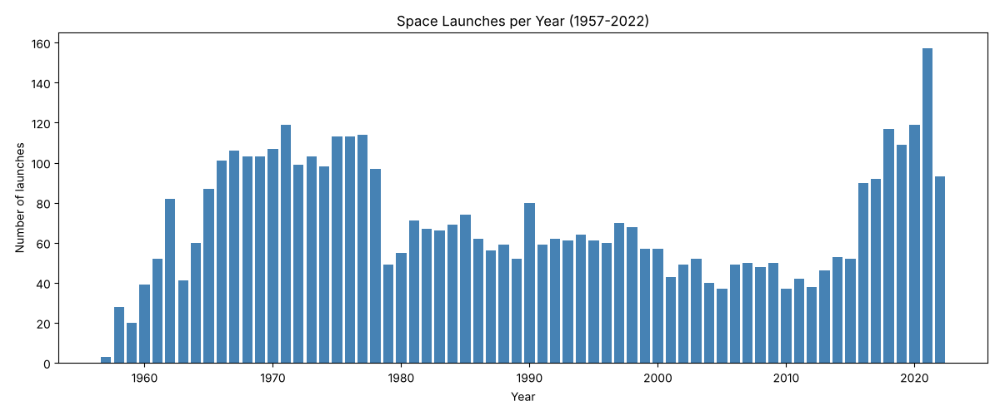

# Apogee: Space Launch Analyzer

**By Avanish Pore**

*Apogee: the highest point a rocket or satellite reaches.*

A Python command-line program that explores every space launch from 1957 to August 2022: how launches have grown over time, which countries and companies launch the most, how often missions succeed, and a search tool for looking up any company, rocket, mission, or year.



## What it does

| Menu option | What you get |
|---|---|
| 1. Overview | Total launches, overall success rate, number of countries, companies, and rockets, plus the first and last launch |
| 2. Launches per year | Launch count for every year with a text bar chart, and the busiest year |
| 3. Success rate by country | Top 10 countries by number of launches, with each one's success rate |
| 4. Top companies and rockets | The 10 companies and 10 rockets with the most launches |
| 5. Success rate by decade | Whether rockets got more reliable over time |
| 6. Search launches | Every launch matching a company, rocket, mission, or year (for example "Falcon 9" or "1969") |
| 7. Chart | Bar chart of launches per year, saved as `launches_per_year.png` |

## The data

This project uses the **Space Missions** dataset from the [Maven Analytics Data Playground](https://mavenanalytics.io/data-playground/space-missions). It covers every space mission from 1957 to August 2022, including the location, date, and result of each launch, the company responsible, and the rocket's name, price, and status. It's a single table of 4,630 launches with 9 fields, and it's public domain.

- `space_missions.csv`: the launch data
- `space_missions_data_dictionary.csv`: what each column means

**The data ends in August 2022,** so 2022 is a partial year and nothing after that is included.

## How to run it

1. Install [Python 3](https://www.python.org/downloads/).
2. Download this repository (green **Code** button, then **Download ZIP**) and unzip it. Keep `launch_analyzer.py` and `space_missions.csv` in the same folder.
3. Open a terminal in that folder and run:
   ```
   python3 launch_analyzer.py
   ```
   On Windows, use `python` instead of `python3`.
4. Type a menu number and press Enter. Option 8 quits.
5. Optional, for the chart (option 7):
   ```
   python3 -m pip install matplotlib
   ```

## Example output

```
============================================================
OVERVIEW
============================================================
Total launches:      4,630
Successful launches: 4,162 (89.9%)
Countries:           16
Companies:           62
Rocket types:        370

First launch: 1957-10-04  Sputnik-1 (RVSN USSR, Sputnik 8K71PS)
Last launch:  2022-07-29  Yaogan 35 Group 03 (CASC, Long March 2D)
```

```
============================================================
SUCCESS RATE BY DECADE
============================================================
Decade      Launches   Success
1950s             51     31.4%
1960s            774     79.1%
1970s           1012     92.7%
1980s            631     93.7%
1990s            642     91.7%
2000s            475     93.3%
2010s            676     93.6%
2020s            369     92.1%
```

Some things the data shows:

- Only about a third of launches succeeded in the 1950s, but since the 1970s the success rate has stayed above 90%.
- 2021 was the busiest year, with 157 launches.

## Decisions about the data

- **Commas inside values:** locations look like `"Site 1/5, Baikonur Cosmodrome, Kazakhstan"`. Splitting each line on commas breaks these apart, so the program uses Python's `csv.DictReader`, which handles quoted values correctly.
- **Mixed text encoding:** most of the file is UTF-8, but a few older lines (like the French company "Armée de l'Air") use a different encoding. The program reads the file line by line and decodes each line the right way instead of crashing.
- **What counts as a success:** only launches marked `Success`. Partial failures and prelaunch failures count as not successful.
- **Country means where the launch site is, not who launched it.** Soviet launches from Baikonur count as Kazakhstan. A few locations that don't end in a country name (like "New Mexico" or "Yellow Sea") are mapped to a country in `COUNTRY_FIXES`. "Pacific Ocean" is Sea Launch, a multinational company that launched from a floating platform, so it's shown as its own entry.
- **One reusable counting function:** `count_by()` counts launches by any category (year, country, company, rocket, decade), so the program doesn't repeat the same loop in five places.

## Data source

Space Missions dataset, [Maven Analytics](https://mavenanalytics.io/data-playground/space-missions), public domain. Covers launches from 1957 through August 2022.

Go Check it out! 
(This app was made with Assistance from AI)
